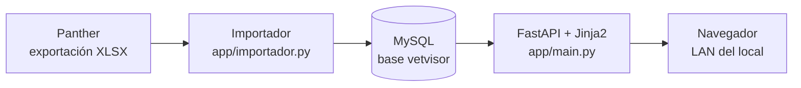

# VetVisor · visor de datos de Panther

Aplicación web en Python para que el personal del local veterinario **consulte**
la información que Panther exporta cada día, desde cualquier equipo de la red
interna. Corre contra MySQL y tiene su propio inicio de sesión.

> **Estado: fase 1 terminada.** Se importan los XLSX, se guardan en MySQL y se
> consultan en el navegador con usuario administrador. Las correcciones con
> auditoría, la carga de archivos y la facturación con QuFact están diseñadas y
> se implementan en las fases siguientes (ver `docs/ARQUITECTURA.md`).

## Cómo funciona



- El importador **no modifica** los XLSX ni la base de Panther: solo lee y copia.
- Se puede correr **varias veces al día**: actualiza las filas existentes e
  inserta las nuevas, sin duplicar.
- El visor **solo lee**. Ninguna pantalla escribe en Panther.

## Requisitos

- Windows con Python 3.11 o superior (probado con 3.14).
- MySQL o MariaDB. En este equipo se usa el de XAMPP en el puerto **3307**.
- Los XLSX exportados por Panther en la carpeta `.src` del repositorio.

## Puesta en marcha

```powershell
# 1. Entorno virtual e instalación de dependencias
py -m venv .venv
.\.venv\Scripts\python.exe -m pip install -r requirements.txt

# 2. Configuración (copia y ajusta si hace falta)
Copy-Item .env.example .env

# 3. Encender MySQL (XAMPP) en el puerto 3307
.\tools\iniciar_mysql.ps1

# 4. Crear la base e importar los XLSX
.\.venv\Scripts\python.exe tools\importar.py

# 5. Arrancar el visor en la red local
.\tools\arrancar_visor.ps1
```

Abre <http://127.0.0.1:8000>. La primera vez que arranca se crea el usuario
administrador con `ADMIN_USUARIO` y `ADMIN_PASSWORD` del `.env`
(por defecto `admin` / `Vetvisor2026*`). **Cambia esa contraseña.**

Para cambiar la contraseña desde la terminal:

```powershell
.\.venv\Scripts\python.exe tools\crear_admin.py --usuario admin
```

## Acceso desde la LAN

El visor escucha en `0.0.0.0:8000`, así que se abre desde cualquier equipo del
local con la IP del servidor:

```
http://192.168.1.50:8000
```

Si Windows bloquea la conexión, hay que permitir el puerto una sola vez (requiere
una consola de administrador):

```powershell
New-NetFirewallRule -DisplayName "VetVisor 8000" -Direction Inbound `
  -LocalPort 8000 -Protocol TCP -Action Allow
```

## Qué se importa

36 tablas de Panther, con el mismo nombre de tabla y de columna que el XLSX:

| Grupo | Tablas |
| --- | --- |
| Clínica | `TranAfiliado` (pacientes y propietarios), `TranInformeMedico`, `TranInformeMedicoHistorico`, `TranExamenes`, `TranRegistroVacunas`, `TranDesparacitacion`, `TranCirugias`, `TranHospitalizacion` |
| Agenda | `TranCalendario`, `disAgenda`, `TranCentroNotificaciones` |
| Finanzas | `TranCuentasClientes`, `TranCorteCuentaCliente`, `TranAbonosCuentasClientes`, `TranCorteCaja` |
| Inventario | `RelProductos`, `CatProductos` |
| Catálogos | servicios, especies, razas, colores, marcas, laboratorios, proveedores, personal, empresa, motivos, plantillas |
| Crecimiento | curvas de peso y talla (`CatSGC_*`) |

Reglas que aplica el importador:

1. **No duplica.** Cada tabla tiene su clave; si la fila ya existe, se actualiza.
2. **Conserva el histórico.** Si un registro ya no viene en el export, permanece
   en la base. La excepción es la agenda (`TranCalendario`), que no tiene clave
   natural: se sincroniza completa en cada importación.
3. **No trunca texto.** Si un valor supera los 255 caracteres, la columna pasa a
   `TEXT` automáticamente.
4. **No guarda credenciales del sistema de origen**: se omiten `vchPassword`,
   `vchPasswordResp`, `vchPasswordCloud`, `vchPin` y `vchUsuario`.
5. **Deja rastro.** Cada corrida queda en `importaciones` con fecha, archivos,
   filas y advertencias, y se ve en el panel y en *Base de datos*.

## Usuarios y seguridad

- Contraseñas con **PBKDF2-SHA256**, sal por usuario y 260 000 iteraciones.
- Sesión en cookie firmada (`SECRETO_SESION`), `SameSite=Lax`, 8 horas.
- Límite de 8 intentos fallidos cada 5 minutos por IP y usuario.
- Solo el rol `admin` puede importar y administrar usuarios.
- Los secretos viven en `.env`, que **no se versiona**.

## Qué copiar al servidor del local

Copia **solo esto**:

```
app\                 (código y plantillas)
tools\               (importador y scripts de arranque)
requirements.txt
.env.example
docs\
README.md
```

**No copies** `\.venv\`, `\.src\`, `storage\` ni `.env`: el entorno se crea en el
servidor, los datos del cliente no viajan en el paquete y la configuración se
escribe allí. En el servidor:

```powershell
py -m venv .venv
.\.venv\Scripts\python.exe -m pip install -r requirements.txt
Copy-Item .env.example .env    # ajusta DB_*, SECRETO_SESION y ADMIN_PASSWORD
```

### Cómo comprobar que quedó bien

1. `.\tools\iniciar_mysql.ps1` y luego `curl http://127.0.0.1:8000/salud` →
   `{"aplicacion":"vetvisor","base_datos":true}`.
2. Entrar con el usuario administrador y ver en el panel los conteos de
   pacientes, informes, exámenes y vacunas.
3. Abrir *Base de datos* y confirmar que la última importación dice **Ok**.
4. Buscar un paciente conocido y abrir su ficha y un informe.

## Problemas frecuentes

| Síntoma | Causa probable | Solución |
| --- | --- | --- |
| «No hay conexión con MySQL» al entrar | MySQL apagado o puerto distinto | `.\tools\iniciar_mysql.ps1`; revisa `DB_PORT` en `.env` |
| El panel muestra 0 en todo | No se importó todavía | `python tools\importar.py` |
| Una tabla aparece vacía | El XLSX no estaba en `.src` | Revisa el nombre del archivo en *Base de datos* |
| La LAN no abre la página | Firewall de Windows | Regla del puerto 8000 (ver arriba) |
| «Usuario o contraseña incorrectos» | Contraseña inicial sin cambiar | `python tools\crear_admin.py --usuario admin` |

## Estructura del repositorio

```
app/
  config.py        lectura de .env
  db.py            conexión SQLAlchemy/MySQL
  esquema.py       catálogo de tablas, tipos y claves
  limpieza.py      normalización de valores de Access
  importador.py    importación idempotente
  consultas.py     SQL de las pantallas
  auth.py          usuarios, contraseñas y sesión
  web.py           plantillas, filtros y contexto
  qufact.py        adaptador de facturación (fase 4)
  main.py          aplicación FastAPI
  rutas/           rutas HTTP (entrada y visor)
  templates/       plantillas Jinja2
  static/          CSS, logo y Bootstrap local
tools/
  importar.py      importación por terminal
  crear_admin.py   crear o restablecer usuarios
  *.ps1            arranque de MySQL y del visor
docs/
  ARQUITECTURA.md  modelo de datos, reglas y fases
  QUFACT_INTEGRACION.md  contrato propuesto con QuFact
```

## Siguientes fases

1. **Actualización con auditoría.** Tabla `correcciones` que guarda el valor
   nuevo por campo, sin tocar el original, y un historial visible de quién
   cambió qué. `auditoria` ya está creada para eso.
2. **Carga de archivos.** Exámenes, imágenes y documentos asociados al paciente.
   La tabla `documentos` y la carpeta `storage/documentos` ya existen; falta la
   pantalla y la validación de tipos y tamaños.
3. **Facturación QuFact.** Endpoint JSON con token en QuFact y emisión desde el
   visor a partir de los movimientos de `TranCuentasClientes`. Contrato en
   `docs/QUFACT_INTEGRACION.md`.
