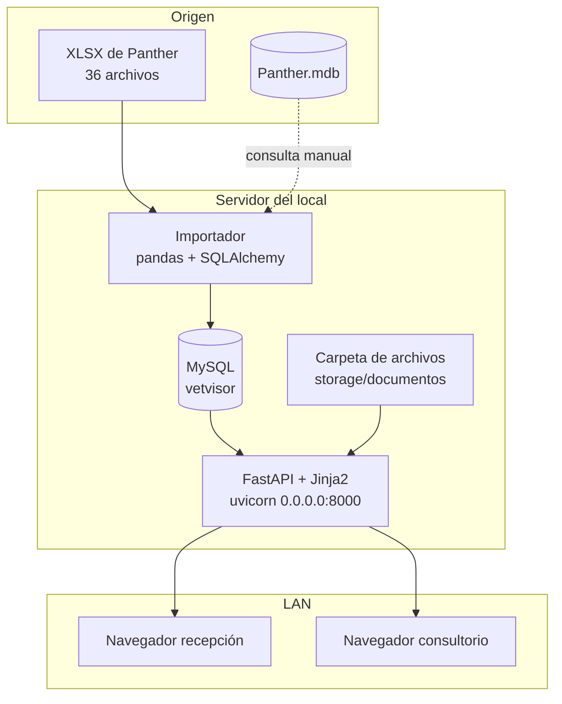
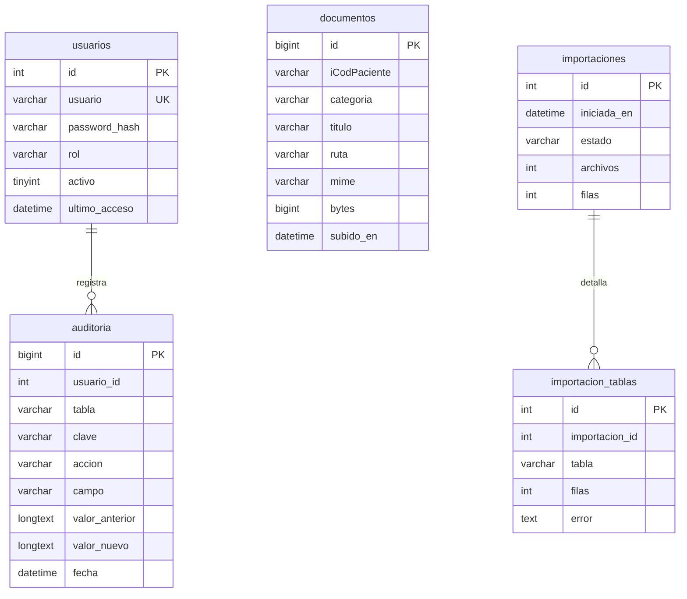

# Arquitectura de VetVisor

## Objetivo y restricciones

El local veterinario trabaja con Panther, que guarda la historia clínica en la
nube y **no permite consultarla desde varios equipos sin licencia**. Panther sí
exporta sus tablas a XLSX (y a una base Access). VetVisor convierte esa
exportación en una base MySQL consultable desde la red interna, sin escribir
nunca en el sistema de origen.

Restricciones que mandan sobre el diseño:

1. **Solo lectura del origen.** No se escribe en Panther ni en los XLSX.
2. **Datos de menores y de clientes.** Nada de credenciales del sistema de
   origen en la copia; el `.env` y los datos no se versionan.
3. **Equipo modesto.** Un solo servidor Windows en el local, sin Docker ni
   servicios en la nube. La interfaz se sirve desde el mismo proceso.
4. **Operación diaria.** La importación tiene que poder correrse varias veces
   sin duplicar ni perder historia, y dejar un registro de qué se cargó.

## Componentes



- `app/importador.py`: lee, normaliza y hace *upsert*. Es el único componente que
  escribe en las tablas espejo.
- `app/consultas.py`: todo el SQL de lectura. Las plantillas no arman consultas.
- `app/rutas/`: dos routers, entrada (`/login`, `/logout`, `/salud`) y visor.
- `app/auth.py`: usuarios, PBKDF2, sesión y límite de intentos.
- `app/static/vendor/bootstrap.min.css`: Bootstrap servido localmente para que el
  visor funcione aunque la LAN no tenga internet.

## Modelo de datos

### Tablas espejo

Son las 36 tablas de Panther, con el mismo nombre y las mismas columnas. Los
tipos se deducen del nombre de la columna:

| Prefijo | Tipo MySQL | Motivo |
| --- | --- | --- |
| `dt…` | `DATETIME` | fechas y horas |
| `d…` | `DECIMAL(18,6)` | importes y medidas |
| `b…`, `ti…` | `TINYINT` | banderas |
| `iCod…`, `iNoPaciente` | `VARCHAR(64)` | los códigos de Panther son números de 27 dígitos |
| `i…`, `si…` | `INT` | contadores |
| `vch…`, `s…` | `VARCHAR(255)` o `LONGTEXT` | texto; `LONGTEXT` en notas clínicas |

Columnas largas declaradas en `COLUMNAS_TEXTO`; si aparece un texto más largo de
lo previsto, el importador cambia la columna a `TEXT` en vez de truncarlo.

### Claves

| Tabla | Clave | Por qué |
| --- | --- | --- |
| `TranAfiliado` | (`iCodPaciente`, `dtFecha`) | el mismo paciente puede tener dos fichas creadas en fechas distintas; se conservan ambas |
| `TranInformeMedico` | `iCodInformeMedico` | único en el export |
| `TranExamenes`, `TranRegistroVacunas`, … | su `iCod…` | únicos en el export |
| `TranCalendario` | `_huella` | no hay combinación de columnas única: la misma mascota puede tener cinco citas iguales el mismo día, distinguidas solo por `iCodCita`, que se repite |

`_huella` es un SHA-1 de todos los valores normalizados de la fila. Como la
agenda no tiene clave estable, se **sincroniza completa** en cada importación:
las filas que ya no vienen en el export se retiran, y si el archivo llega vacío
no se purga nada (se prefiere conservar lo anterior).

### Tablas propias



`documentos` y `auditoria` se crean ya en la fase 1, pero las pantallas que las
usan llegan en las fases 2 y 3. Así la base no cambia de forma entre entregas.

## Reglas de importación

1. Se lee el XLSX con pandas (`dtype=str`) para no perder ceros a la izquierda.
2. Se normaliza: saltos `_x000D_` de Access, acentos descompuestos (NFC),
   caracteres de control y vacíos (`nan`, `.`, `<empty>`).
3. Se convierten fechas, importes y banderas. Un valor imposible queda `NULL` y
   se cuenta como advertencia; no detiene la tabla.
4. La fila se identifica por la clave declarada. Si la clave no existe en la
   tabla, la tabla se reconstruye (es un espejo).
5. `INSERT … ON DUPLICATE KEY UPDATE` por lotes de 400 filas.
6. Cada corrida se registra en `importaciones` e `importacion_tablas`.

Consecuencia práctica: correr el importador dos veces seguidas deja los mismos
8 244 registros, no el doble.

## Seguridad

| Riesgo | Medida |
| --- | --- |
| Contraseñas en texto plano | PBKDF2-SHA256, sal por usuario, 260 000 iteraciones |
| Robo de cookie | cookie firmada, `SameSite=Lax`, 8 h; HTTPS delante si sale del local |
| Fuerza bruta | 8 intentos cada 5 minutos por IP y usuario |
| Inyección SQL | parámetros en todas las consultas; los nombres de tabla salen del catálogo, nunca de la URL |
| Credenciales de Panther | se omiten del import |
| Datos en el repositorio | `.env`, `.src/` y `storage/` están en `.gitignore` |
| Escritura indebida | ninguna ruta escribe en las tablas espejo |

## Fases siguientes

### Fase 2 · Correcciones con auditoría

Decisión del cliente: las correcciones **no vuelven a Panther**, se guardan en
MySQL y se conserva el valor original.

```sql
CREATE TABLE correcciones (
  id BIGINT AUTO_INCREMENT PRIMARY KEY,
  tabla VARCHAR(64) NOT NULL,
  clave VARCHAR(128) NOT NULL,
  campo VARCHAR(64) NOT NULL,
  valor LONGTEXT NULL,
  usuario_id INT NOT NULL,
  usuario VARCHAR(64) NOT NULL,
  motivo VARCHAR(255) NULL,
  creada_en DATETIME NOT NULL,
  UNIQUE KEY uk_correccion (tabla, clave, campo)
);
```

- La ficha lee `COALESCE(correccion.valor, espejo.campo)`; la pantalla muestra el
  original y el corregido.
- Cada cambio se replica en `auditoria` con valor anterior y nuevo.
- La importación **nunca** toca `correcciones`: si Panther cambia el dato, la
  corrección sigue visible y se avisa del conflicto.
- Campos editables en la primera entrega de la fase: contacto del propietario,
  observaciones, y notas internas del visor.

### Fase 3 · Archivos

- `POST /pacientes/{codigo}/documentos` con `multipart/form-data`.
- Validación: extensión y tipo MIME permitidos (`pdf`, `jpg`, `png`, `webp`,
  `dcm`), tamaño máximo configurable (por defecto 15 MB).
- Nombre en disco aleatorio (UUID) y nombre original solo en la base: evita
  colisiones y rutas maliciosas.
- Descarga autenticada por `/documentos/{id}`, nunca por ruta directa.

### Fase 4 · Facturación QuFact

Contrato en [`QUFACT_INTEGRACION.md`](QUFACT_INTEGRACION.md). El visor arma los
ítems desde `TranCuentasClientes` y QuFact emite, firma y envía al SRI. La
referencia `panther:{iCodCuentaCliente}` evita duplicados.
